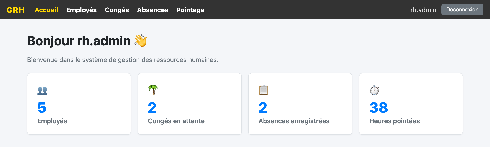
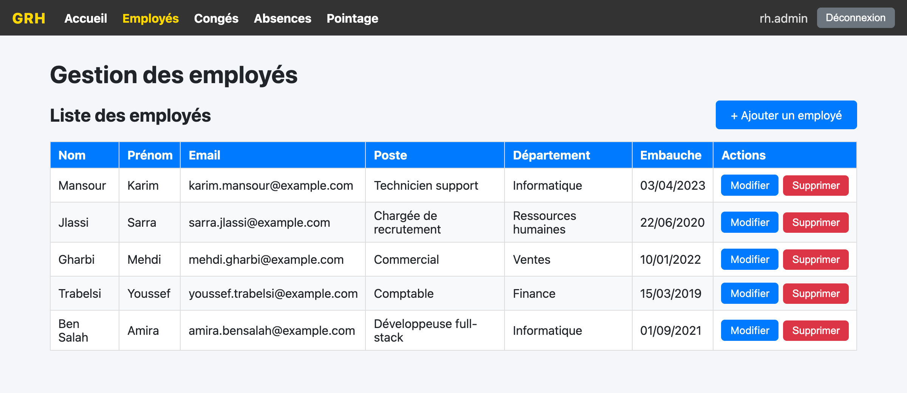
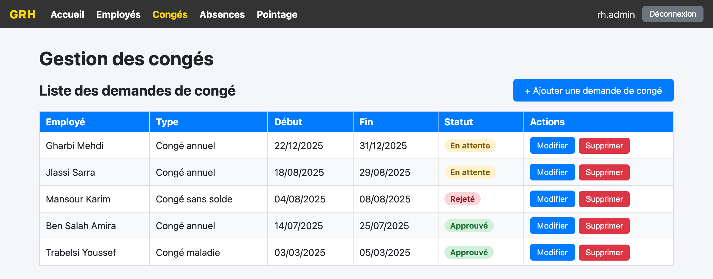
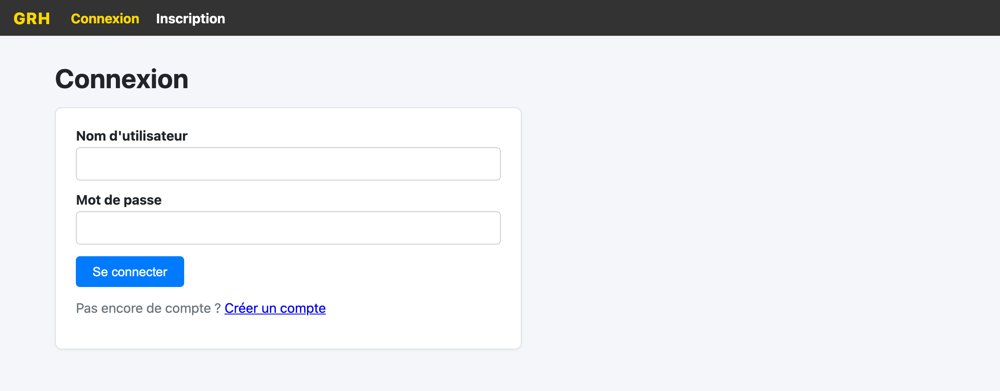
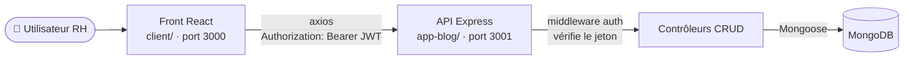
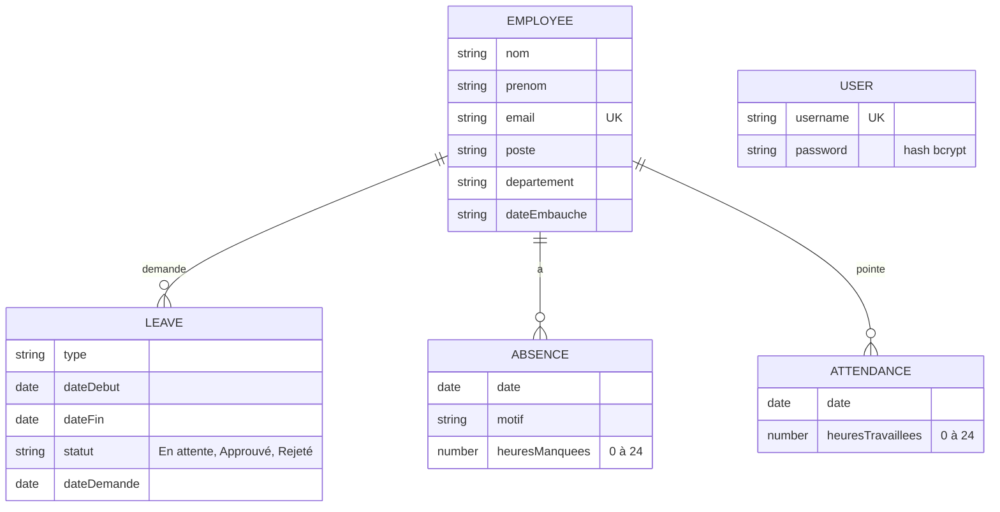

<div align="center">

# 👥 GRH — Système de Gestion des Ressources Humaines

**Application web MERN pour gérer les employés, les demandes de congé, les absences et le pointage,**
**avec une API REST sécurisée par JWT et une interface React.**


<br>



</div>

---

## 📌 Sommaire

- [Fonctionnalités](#-fonctionnalités)
- [Aperçu](#-aperçu)
- [Architecture](#️-architecture)
- [Installation](#-installation)
- [Configuration](#️-configuration)
- [API REST](#-api-rest)
- [Modèle de données](#️-modèle-de-données)
- [Sécurité](#-sécurité)
- [Structure du projet](#-structure-du-projet)
- [Améliorations possibles](#️-améliorations-possibles)

---

## ✨ Fonctionnalités

| | Module | Ce qu'on peut faire |
|:--:|:--|:--|
| 📊 | **Tableau de bord** | Nombre d'employés, congés en attente, absences et heures pointées |
| 👤 | **Employés** | Ajouter, modifier, supprimer : nom, poste, département, date d'embauche. La suppression retire aussi les congés, absences et pointages de l'employé |
| 🌴 | **Congés** | Demandes de congé avec type et dates. Statut **En attente → Approuvé / Rejeté** |
| 📋 | **Absences** | Date, motif et heures manquées par employé |
| ⏱️ | **Pointage** | Heures travaillées par jour et par employé |
| 🔐 | **Comptes** | Inscription, connexion et déconnexion. Toutes les pages et routes de l'API sont réservées aux utilisateurs connectés |

Chaque formulaire est validé côté serveur (champs obligatoires, email unique, date de fin après la date de début, heures entre 0 et 24…). Les erreurs s'affichent en clair dans l'interface.

## 📸 Aperçu

<table>
  <tr>
    <td colspan="2"></td>
  </tr>
  <tr>
    <td width="60%"></td>
    <td width="40%"></td>
  </tr>
  <tr>
    <td align="center"><b>Congés</b> : statut en couleur</td>
    <td align="center"><b>Connexion</b></td>
  </tr>
</table>

## 🏗️ Architecture



| Couche | Technologies |
|:--|:--|
| **Front-end** | React 18, React Router 6, Axios |
| **Back-end** | Node.js, Express 4, Mongoose 8 |
| **Authentification** | JSON Web Token (jsonwebtoken), mots de passe hachés avec bcrypt |
| **Base de données** | MongoDB |

## 🚀 Installation

### Prérequis

- **Node.js 18 ou plus récent**
- **MongoDB**, au choix :
  - installé en local ;
  - une base gratuite sur [MongoDB Atlas](https://www.mongodb.com/atlas) ;
  - un conteneur Docker : `docker run -d --name mongo -p 27017:27017 mongo:7`.

### 1. Cloner le projet

```bash
git clone https://github.com/slimzrrk/Syst-me_de_Gestion_des_Ressources_Humaines_-GRH-.git grh
cd grh
```

### 2. Lancer l'API

```bash
cd app-blog
npm install
cp .env.example .env        # Windows : copy .env.example .env
```

Ouvrez `.env` et remplacez `JWT_SECRET` par une longue chaîne aléatoire, par exemple celle générée par :

```bash
node -e "console.log(require('crypto').randomBytes(48).toString('hex'))"
```

Puis démarrez l'API :

```bash
npm run dev                 # redémarre automatiquement à chaque modification (ou : npm start)
# → API GRH en écoute sur http://localhost:3001
```

### 3. Lancer le front (dans un second terminal)

```bash
cd client
npm install
npm start
# → http://localhost:3000
```

### 4. Première connexion

Ouvrez [http://localhost:3000](http://localhost:3000), cliquez sur **Inscription**, créez votre compte puis connectez-vous.

## ⚙️ Configuration

**API (`app-blog/.env`)**

| Variable | Rôle | Défaut |
|:--|:--|:--|
| `PORT` | Port de l'API | `3001` |
| `DATABASE_URL` | Adresse MongoDB | `mongodb://127.0.0.1:27017/grh` |
| `JWT_SECRET` | Clé de signature des jetons (**obligatoire**) | — |
| `JWT_EXPIRES_IN` | Durée de validité d'une session | `8h` |
| `CLIENT_URL` | Adresse du front autorisée par CORS | `http://localhost:3000` |

**Front (`client/.env`, facultatif)**

| Variable | Rôle | Défaut |
|:--|:--|:--|
| `REACT_APP_API_URL` | Adresse de l'API | `http://localhost:3001/api` |

## 🔌 API REST

Toutes les routes sont préfixées par `/api`. Seules `/login` et `/register` sont publiques. Les autres demandent l'en-tête `Authorization: Bearer <jeton>`.

| Ressource | Routes |
|:--|:--|
| Authentification | `POST /register` · `POST /login` · `GET /me` |
| Employés | `GET` `POST /employee` · `GET` `PUT` `DELETE /employee/:id` |
| Congés | `GET` `POST /leave` · `GET` `PUT` `DELETE /leave/:id` |
| Absences | `GET` `POST /absence` · `GET` `PUT` `DELETE /absence/:id` |
| Pointage | `GET` `POST /attendance` · `GET` `PUT` `DELETE /attendance/:id` |

<details>
<summary><b>Exemple avec curl</b></summary>

```bash
# Connexion : récupère un jeton
TOKEN=$(curl -s -X POST http://localhost:3001/api/login \
  -H 'Content-Type: application/json' \
  -d '{"username":"rh.admin","password":"MotDePasse123"}' | node -pe 'JSON.parse(require("fs").readFileSync(0)).token')

# Ajout d'un employé
curl -X POST http://localhost:3001/api/employee \
  -H "Authorization: Bearer $TOKEN" -H 'Content-Type: application/json' \
  -d '{"nom":"Ben Salah","prenom":"Amira","email":"amira@example.com","poste":"Développeuse","departement":"Informatique","dateEmbauche":"2021-09-01"}'
```

| Code | Signification |
|:--|:--|
| `200` / `201` | Succès |
| `400` | Données invalides (le message précise le champ en cause) |
| `401` | Non connecté, ou session expirée |
| `404` | Élément introuvable |
| `409` | Email ou nom d'utilisateur déjà utilisé |

</details>

## 🗄️ Modèle de données



## 🔒 Sécurité

- **Mots de passe hachés** avec bcrypt, jamais renvoyés par l'API.
- **Routes protégées** : un middleware vérifie le jeton JWT sur toutes les routes de données.
- **Jeton minimal** : il contient seulement l'identifiant et le nom d'utilisateur, il est signé avec la clé `JWT_SECRET` du fichier `.env` et il expire (8 h par défaut).
- **Session expirée** : le front efface la session et revient à la page de connexion.
- **Message d'erreur unique** à la connexion : on ne révèle pas si un compte existe.
- **Validation côté serveur** de toutes les données, avec liste blanche des champs acceptés.
- **API robuste** : les erreurs (validation, identifiant invalide, doublon, JSON mal formé) donnent une réponse 4xx claire et n'arrêtent jamais le serveur.
- **CORS** limité à l'adresse du front.
- **Secrets hors du dépôt** : les fichiers `.env` sont ignorés par Git, seul `.env.example` est versionné.

## 📁 Structure du projet

```text
grh/
├── app-blog/                      # 🟢 API Node.js / Express
│   ├── index.js                   # Point d'entrée : Express, connexion MongoDB, erreurs
│   ├── .env.example               # Modèle de configuration
│   └── src/
│       ├── config/config.js       # Lecture des variables d'environnement
│       ├── database/db.config.js  # Connexion Mongoose
│       └── api/
│           ├── routes/routes.js   # Déclaration des routes /api/...
│           ├── middlewares/       # auth (JWT), gestion des erreurs, async
│           ├── controllers/       # CRUD générique + employés, congés, absences, pointage, utilisateurs
│           └── models/            # Schémas Mongoose et validations
├── client/                        # 🔵 Front React
│   ├── public/index.html
│   └── src/
│       ├── App.js                 # Routes (publiques / protégées)
│       ├── api.js                 # Client axios : URL de l'API, jeton, erreurs
│       ├── auth.js                # Session (jeton stocké dans le navigateur)
│       ├── components/            # Listes, barre de navigation, garde de route…
│       └── pages/                 # Tableau de bord, formulaires d'ajout et de modification
└── docs/screenshots/              # Captures du README
```

## 🛣️ Améliorations possibles

- [ ] **Rôles** (administrateur RH, manager, employé) et **inscription sur invitation**. Aujourd'hui, toute personne qui crée un compte accède à toutes les données.
- [ ] **Solde de congés** calculé automatiquement selon les congés approuvés.
- [ ] **Recherche, filtres et pagination** dans les listes.
- [ ] **Tests automatisés** (Jest + Supertest pour l'API, React Testing Library pour le front).
- [ ] **Docker Compose** pour lancer MongoDB, l'API et le front en une seule commande.
- [ ] **Export** des pointages et des absences en CSV ou PDF.

---

<div align="center">

Réalisé par **[@slimzrrk](https://github.com/slimzrrk)** · ⭐ Si ce projet vous est utile, n'hésitez pas à lui donner une étoile !

</div>
